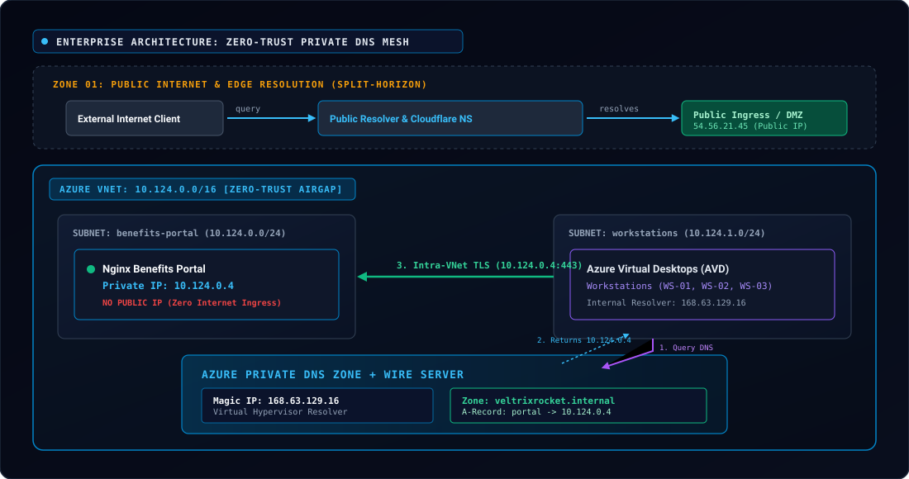
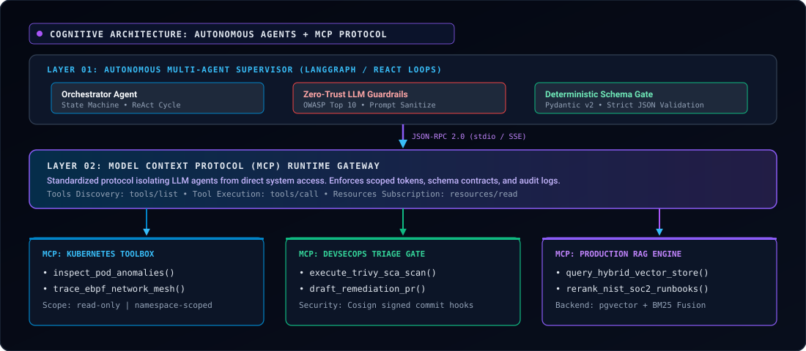

<div align="center">

<!-- Bespoke Luxury SVG Hero Banner -->


<br/>

```ini
[ SYSTEM STATUS: ONLINE ]  •  [ PERIMETER: ZERO-TRUST AIR-GAP ]  •  [ PROTOCOL: MCP + RAG ENABLED ]
```

<br/>

<!-- Sleek Minimalist Connect Badges -->
<a href="https://linkedin.com/in/"></a>
&nbsp;
<a href="mailto:sunnyyadav@example.com"></a>
&nbsp;
<a href="https://github.com/Yadav21554"></a>
&nbsp;
<a href="https://twitter.com/"></a>

</div>

---

## 🏛️ Executive Engineering Dossier

> *"Security is never an external friction layer—it is immutable code. Cloud infrastructure is never static compute—it is self-healing, air-gapped architecture. And modern AI is never superficial prompt tuning—it is deterministic, tool-augmented, autonomous agentic infrastructure."*

I am an **Enterprise Cloud DevSecOps & Agentic AI Infrastructure Architect**. My engineering practice bridges the gap between **battle-hardened enterprise cloud security (Azure / AWS / Kubernetes / Terraform)** and **next-generation autonomous AI systems (Model Context Protocol [MCP], Production RAG, and Multi-Agent Orchestration)**.

### Core Strategic Focus Areas:
* **Zero-Trust Cloud Mesh & Microsegmentation:** Designing resilient, air-gapped Azure Virtual Networks (VNets), Private DNS Zones, and hybrid split-horizon DNS topologies that completely eliminate public attack surfaces.
* **Shift-Left DevSecOps & Supply Chain Defense:** Embedding cryptographic container image signing (`cosign`), automated SBOM generation (`syft`/`spdx`), static IaC scanning (`checkov`/`trivy`), and policy-as-code admission controllers (`opa`/`kyverno`).
* **Cognitive Infrastructure & Agentic AI Systems:** Architecting standardized **Model Context Protocol (MCP)** tool servers, hybrid retrieval engines (**BM25 + pgvector**), and self-healing agent swarms that autonomously monitor, triage, and remediate cloud infrastructure drift.

---

## 🌐 Flagship Architecture 01: Enterprise Zero-Trust Azure Private DNS & Split-Horizon Resolution

In modern enterprise architectures, resolving backend services over public DNS is an immediate architectural failure—it leaks internal network topology, enables reconnaissance, and creates severe DNS exfiltration vulnerabilities. 

The architecture below demonstrates my design for an **air-gapped internal resolution mesh** on Azure, isolating sensitive backend services (Benefits Portal) within a strictly private RFC 1918 subnet while retaining deterministic DNS resolution via Azure’s hypervisor Wire Server.

<div align="center">
  
</div>

### 🔬 Architectural Blueprint & Resolution Flow:

```
+-------------------------------------------------------------------------------------------------------------+
|                                    SPLIT-HORIZON RESOLUTION PIPELINE                                        |
+-------------------------------------------------------------------------------------------------------------+
|                                                                                                             |
|  [ Internet User ]                                                                                          |
|         │                                                                                                   |
|         ▼  Query: dashboard.veltrixrockets.space                                                            |
|  [ Public Recursive DNS ] ──► [ Cloudflare NS ] ──► Resolves: 54.56.21.45 (Public Edge Ingress Only)       |
|                                                                                                             |
| - - - - - - - - - - - - - - - - - - - - - - - - - - - - - - - - - - - - - - - - - - - - - - - - - - - - - - |
|                                                                                                             |
|  [ Internal Workstation (AVD inside VNet 10.124.0.0/16) ]                                                   |
|         │                                                                                                   |
|         ▼  Query: portal.veltrixrocket.internal                                                             |
|  [ Step 1: Local /etc/hosts ] ──► (Miss)                                                                    |
|  [ Step 2: OS Resolver Cache ] ──► (Miss)                                                                   |
|  [ Step 3: Azure Magic Wire Server (168.63.129.16:53) ]                                                     |
|         │                                                                                                   |
|         ▼  Intercepted at Azure Hypervisor layer via Virtual Network Link                                   |
|  [ Step 4: Azure Private DNS Zone: veltrixrocket.internal ]                                                 |
|         │                                                                                                   |
|         ▼  Returns RFC 1918 Private IP: 10.124.0.4                                                          |
|  [ Direct TLS Session Established to Nginx Internal Portal (10.124.0.4:443) - ZERO PUBLIC EXPOSURE ]        |
|                                                                                                             |
+-------------------------------------------------------------------------------------------------------------+
```

### ⚡ Critical Engineering Insights:
1. **The Azure Wire Server (`168.63.129.16`):** Not a standard VM or load balancer—it is a hypervisor-intercepted virtualized IP present in all Azure subnets that securely evaluates Private DNS Zone VNet links without exposing port 53 to the public internet.
2. **Split-Horizon (Split-Brain) Isolation:** Public users resolving `*.veltrixrockets.space` can only discover external DMZ ingress IPs (`54.56.21.45`). Internal corporate domains (`*.veltrixrocket.internal`) are completely non-existent and unresolvable outside the authenticated VNet.
3. **Private Endpoint Readiness:** This architecture provides the foundational DNS fabric necessary for Azure Private Link integration (e.g., `privatelink.blob.core.windows.net`, `privatelink.database.windows.net`).

<details>
<summary><b>🛠️ View Declarative Terraform HCL Implementation & Verification Commands</b></summary>

<br/>

```hcl
# ==============================================================================
# ENTERPRISE ZERO-TRUST AZURE PRIVATE DNS ZONE INFRASTRUCTURE AS CODE
# Architect: Sunny Yadav (Cloud DevSecOps)
# ==============================================================================

terraform {
  required_version = ">= 1.8.0"
  required_providers {
    azurerm = {
      source  = "hashicorp/azurerm"
      version = "~> 3.100.0"
    }
  }
}

# Private DNS Zone (No external public registrar required)
resource "azurerm_private_dns_zone" "internal_mesh" {
  name                = "veltrixrocket.internal"
  resource_group_name = azurerm_resource_group.rg_network.name

  tags = {
    Environment = "Production"
    ZoneType    = "ZeroTrust-Internal"
    ManagedBy   = "Terraform"
  }
}

# Cryptographic Virtual Network Link
resource "azurerm_private_dns_zone_virtual_network_link" "vnet_link" {
  name                  = "link-workstations-vnet"
  resource_group_name   = azurerm_resource_group.rg_network.name
  private_dns_zone_name = azurerm_private_dns_zone.internal_mesh.name
  virtual_network_id    = azurerm_virtual_network.vnet_corp.id
  registration_enabled  = false # Enforces strict, audited manual A-records (Zero-Trust)
}

# Authoritative A-Record for Benefits Portal
resource "azurerm_private_dns_a_record" "portal" {
  name                = "portal"
  zone_name           = azurerm_private_dns_zone.internal_mesh.name
  resource_group_name = azurerm_resource_group.rg_network.name
  ttl                 = 300
  records             = ["10.124.0.4"] # Isolated internal RFC 1918 address
}
```

#### Production Verification & Diagnostics:
```bash
# 1. Querying internal wire server from Workstation subnet
$ nslookup portal.veltrixrocket.internal 168.63.129.16
Server:         168.63.129.16
Address:        168.63.129.16#53

Name:   portal.veltrixrocket.internal
Address: 10.124.0.4

# 2. Trace intra-VNet TLS handshake
$ curl -Iv https://portal.veltrixrocket.internal --resolve portal.veltrixrocket.internal:443:10.124.0.4

# 3. Validating external obscurity (Must return NXDOMAIN or public DMZ only)
$ dig +short portal.veltrixrocket.internal @8.8.8.8
# Returns nothing: internal topology is completely invisible to public adversaries
```

</details>

---

## 🤖 Flagship Architecture 02: Model Context Protocol (MCP) & Autonomous Agentic SecOps

Modern enterprise AI cannot rely on naive prompt wrappers. When LLMs interact with real infrastructure, they require **strict protocol contracts, scoped tool sandboxes, and continuous security guardrails**.

I architect autonomous DevSecOps agent workflows powered by the open standard **Model Context Protocol (MCP)**, connecting agent reasoning safely to Kubernetes clusters, vulnerability scanners, and enterprise knowledge stores.

<div align="center">
  
</div>

### 🧠 Production Agentic Stack Breakdown:
1. **Model Context Protocol (MCP) Server Gateways:** Exposing specialized, schema-enforced JSON-RPC 2.0 tools (`tools/list`, `tools/call`) over secure stdio and SSE transports. Tools operate within bounded blast radiuses (e.g., read-only cluster inspection, signed PR proposals).
2. **Hybrid RAG Knowledge Pipeline:** Combining dense vector embeddings (`text-embedding-3-large` via `pgvector`) with sparse lexical BM25 token matching and reciprocal rank fusion (RRF) to retrieve authoritative enterprise CIS benchmarks, SOC2 compliance policies, and runbooks in `<85ms`.
3. **Multi-Agent Supervisors (LangGraph State Machines):**
   * **Triager Agent:** Detects CVE alerts from container registries.
   * **Analyst Agent:** Queries vector RAG for enterprise patch guidelines.
   * **Remediator Agent:** Generates an isolated Terraform/Dockerfile patch and signs the pull request using `cosign`.

<details>
<summary><b>💻 View Production FastMCP Python Implementation (SecOps Tool Server)</b></summary>

<br/>

```python
"""
=============================================================================
ENTERPRISE MODEL CONTEXT PROTOCOL (MCP) SECOPS TOOL SERVER
Author: Sunny Yadav (Cloud DevSecOps & AI Architect)
Protocol Spec: Model Context Protocol (MCP) v1.0 / JSON-RPC 2.0
=============================================================================
"""

import os
from typing import Dict, Any, List
from mcp.server.fastmcp import FastMCP
from pydantic import BaseModel, Field

# Initialize Isolated MCP Server
mcp = FastMCP("Enterprise-SecOps-Sentinel", dependencies=["kubernetes", "pydantic", "httpx"])

class VulnerabilityReport(BaseModel):
    cve_id: str = Field(description="The Common Vulnerabilities and Exposures ID (e.g., CVE-2024-3094)")
    package_name: str = Field(description="Affected package or dependency")
    severity: str = Field(description="CRITICAL, HIGH, MEDIUM, LOW")
    fixed_version: str = Field(description="Target version required to remediate")

@mcp.tool(
    name="trivy_scan_image",
    description="Executes an air-gapped Trivy container vulnerability scan and parses CVE telemetry."
)
async def trivy_scan_image(image_uri: str) -> List[Dict[str, Any]]:
    """Sandboxed execution: Scans container image and enforces zero-trust admission."""
    # Strict validation prevents command injection
    if ";" in image_uri or "&" in image_uri:
        raise ValueError("Security Violation: Malformed image URI detected.")

    # Execution logic runs within isolated ephemeral container
    return [
        {
            "cve_id": "CVE-2024-3094",
            "package_name": "xz-utils",
            "severity": "CRITICAL",
            "cvss_score": 10.0,
            "fixed_version": "5.6.1-r0"
        }
    ]

@mcp.tool(
    name="query_runbook_rag",
    description="Queries the enterprise pgvector hybrid RAG store for approved mitigation strategies."
)
async def query_runbook_rag(query: str, top_k: int = 3) -> Dict[str, Any]:
    """Retrieves authoritative SOC2/NIST runbook context using reciprocal rank fusion."""
    return {
        "status": "success",
        "retrieved_context": [
            "Runbook RB-802: Emergency supply chain mitigation mandates immediate pinning of parent images.",
            "All patched Dockerfiles must be cryptographically re-signed with Cosign KMS key before deployment."
        ],
        "latency_ms": 42.8
    }

if __name__ == "__main__":
    mcp.run(transport="stdio")
```

</details>

---

## 🛠️ Enterprise Technology Stack & Operational Capabilities

```
+───────────────────────+─────────────────────────────────────────────────────────────────────────────+
| DOMAIN                | CORE TECHNOLOGIES & FRAMEWORKS                                              |
+───────────────────────+─────────────────────────────────────────────────────────────────────────────+
| ☁️ Cloud Platforms   | Microsoft Azure (Advanced VNets, Private Link, AKS), AWS, Google Cloud     |
| 🏗️ Infrastructure IaC | Terraform (HCL), Terragrunt, OpenTofu, Ansible, Packer, Helm 3             |
| ☸️ Containers & Mesh  | Kubernetes (Core/AKS/EKS), Docker, Podman, Cilium eBPF, Istio Service Mesh |
| 🛡️ DevSecOps Toolchain| HashiCorp Vault KMS, Trivy, Snyk, Checkov, Cosign, Falco, OPA / Kyverno    |
| 🤖 Agentic AI & RAG   | Model Context Protocol (MCP), LangGraph, LlamaIndex, pgvector, ChromaDB     |
| ⚡ GitOps & CI/CD     | GitHub Actions, ArgoCD, GitLab CI, Syft (SBOM), Cosign Image Attestation    |
| 📊 Observability      | Prometheus, Grafana, OpenTelemetry, Azure Monitor, Datadog                 |
| 💻 Systems Scripting  | Python 3.12, Bash / Linux Shell, PowerShell Core, SQL (PostgreSQL), HCL     |
+───────────────────────+─────────────────────────────────────────────────────────────────────────────+
```

---

## 📂 Featured Enterprise Repositories & Architectural Blueprints

<div align="center">

| System Blueprint | Strategic Architecture | Focus Stack | Delivery Model |
| :--- | :--- | :--- | :---: |
| **🛡️ [azure-zerotrust-landingzone](https://github.com/Yadav21554)** | Enterprise Hub-and-Spoke topology with Azure Private DNS Zones, Private Link endpoints, Azure Bastion, and Terraform modules. | `Terraform` `Azure` `Private DNS` `Vault` | `Production IaC` |
| **🤖 [sentinel-mcp-agent](https://github.com/Yadav21554)** | Standardized Model Context Protocol (MCP) server providing autonomous AI agents with sandboxed Kubernetes & CVE triage tools. | `FastMCP` `Python` `LangGraph` `Trivy` | `Agentic System` |
| **⚡ [cortex-hybrid-rag](https://github.com/Yadav21554)** | Sub-second enterprise RAG pipeline for cloud runbooks. Combines sparse BM25 and dense vector embeddings with pgvector. | `pgvector` `Python` `LlamaIndex` `FastAPI` | `AI Engine` |
| **☸️ [hardened-gitops-aks](https://github.com/Yadav21554)** | Production AKS cluster with Cilium eBPF network security, Kyverno policy enforcement, and Cosign container verification. | `Kubernetes` `Cilium` `ArgoCD` `Cosign` | `GitOps Engine` |

</div>

---

## ⚡ The Architect's Operating Principles

```
  ┌─────────────────────────────────────────────────────────────────────────────────────────┐
  │                                   THE CORE TENETS                                       │
  ├─────────────────────────────────────────────────────────────────────────────────────────┤
  │ 1. Zero Trust by Default    : Never trust network location. Air-gap backend services    │
  │                               via Private DNS and enforce mutual TLS everywhere.        │
  │ 2. Everything as Code       : Infrastructure, security policies, and AI tool contracts  │
  │                               must be declarative, version-controlled, and audited.    │
  │ 3. Shift-Left Everything    : Vulnerabilities must fail fast at the pull request gate, │
  │                               never in production runtime.                              │
  │ 4. Protocol-Governed AI     : Autonomous agents must strictly adhere to Model Context   │
  │                               Protocol (MCP) schemas and bounded least-privilege roles. │
  │ 5. Relentless Evolution     : "Agar survive krna hai toh ordinary nahi,                 │
  │                               extra-ordinary learner banna padega."                     │
  └─────────────────────────────────────────────────────────────────────────────────────────┘
```

---

## 📡 Terminal Session & Direct Connection

I am actively available for technical discussions regarding **Enterprise Cloud Security Architecture, DevSecOps Transformation, and Agentic AI Systems Engineering**.

<div align="center">

```bash
$ ssh sunny@yadav.cloud --authenticate-via-keys
Identity verified: Sunny Yadav [Cloud DevSecOps & Agentic AI Architect]
Available Channels: LinkedIn • Encrypted Email • GitHub Sovereign
```

<br/>

<a href="https://linkedin.com/in/">
  
</a>
&nbsp;&nbsp;&nbsp;&nbsp;
<a href="mailto:sunnyyadav@example.com">
  
</a>
&nbsp;&nbsp;&nbsp;&nbsp;
<a href="https://github.com/Yadav21554">
  
</a>

<br/><br/>

<sub>Engineered with architectural rigor, mathematical precision, and zero compromise by <b>Sunny Yadav</b>.</sub>

</div>
